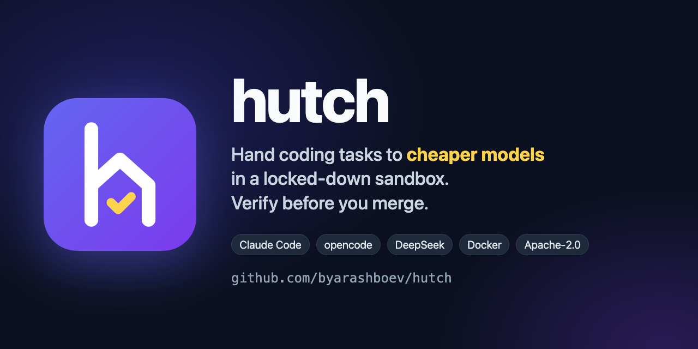

<p align="center"></p>

# hutch

**Let Claude Code, Codex or any host agent hand bounded coding tasks to cheaper models (DeepSeek, Kimi, GLM, Qwen via
OpenCode Go, or the DeepSeek API) in a locked-down Docker sandbox, then verify the result before it reaches your
repository.**

[](LICENSE)
[](skills/hutch/SKILL.md)

hutch hands one bounded coding task to a cheaper coding agent running in an isolated container, and gives the result
back to your main agent (or to you) for review. The sandbox agent writes the code; the host side writes the brief and
verifies.

- **Agents:** the [opencode](https://opencode.ai) CLI (default) or Claude Code.
- **Providers:** OpenCode Go (default) or the DeepSeek API. The model is chosen by the kind of work (`HUTCH_KIND`).
- **Isolation:** the container has no capabilities, sees only its own clone of the repository, and reaches only the
  model API through an allowlist proxy. Results come back as a git bundle; the host never runs git inside the
  agent's clone.
- **Any project:** each project describes its toolchain, checks and protected paths in a small config directory.

## Why

- **Cost.** Your strong model writes a short brief and reviews a diff; a cheap model does the reading, coding, testing
  and committing.
- **Containment.** The sandbox has no capabilities and its own clone of the repository, and reaches nothing but the
  model API: no package registry, Git host, DNS or host port.
- **Verification.** `hutch verify` rejects any change outside the task's allow list or in a protected path, then runs
  the project's checks offline. You (or your agent) still review the diff before taking the commits.

## Example run

One task on a small Node project: add seconds and days to a duration parser and reject invalid input.

| | |
|---|---|
| Model | `HUTCH_KIND=script` → `deepseek-v4.1-flash` on OpenCode Go |
| Time | 7 min 18 s, exit 0 |
| Result | 3 commits, 2 files, tests from 2 to 15, a self-review with a 10-mutation table |
| `hutch verify` | both paths allowed, 15/15 tests pass in the offline container |
| `hutch isolation` | model host reachable; GitHub, npm, PyPI, DNS and host ports blocked; `CapEff` all zeros |

## How it works

```
host                                          container (no network except the model API)
----                                          -------------------------------------------
hutch new    clone base branch  ───────────▶  /work (private clone, branch hutch/<task>)
hutch run    brief + primer + rules ───────▶  agent edits, tests, commits
hutch export                     ◀───────────  git bundle (git runs in a network-less container)
hutch verify fetch → refs/hutch/<task>
             path rules (allow / protected)
             project checks, offline container
you          review the diff, take the commits
```

## Requirements

- macOS or Linux with Docker. On macOS the system bash 3.2 is enough.
- `git`, `python3` (only for the Claude Code agent's mid-run messages).
- An OpenCode Go subscription or a DeepSeek API key.
- arm64 or x86-64 (amd64): the opencode binary is pinned by sha256 for both in `image/Dockerfile`.

## Install

```sh
git clone <this repository> ~/hutch
ln -s ~/hutch/hutch ~/.local/bin/hutch          # any directory on PATH
security add-generic-password -a "$USER" -s opencode-go -w   # macOS: prompts for the OpenCode Go key
hutch build                                      # base image, proxy, networks
hutch status
```

On Linux store the key with `secret-tool store --label='hutch opencode-go' service opencode-go`, or export
`HUTCH_API_KEY`. For DeepSeek, use the service name `deepseek-api` and `HUTCH_PROVIDER=deepseek HUTCH_AGENT=claude`.

Updates: `git -C ~/hutch pull`, then `hutch build` if `image/` or `proxy/` changed. Every project uses the same
checkout, so a fix reaches all of them at once.

## Set up a project

Open your agent in the project and ask it to use hutch. The agent runs `hutch status`, sees that the project is not
set up, and follows [AGENTS.md](AGENTS.md#project-setup): it reads the project, asks you a few questions (consent to
send the code to the provider, where to keep the config, toolchain, checks, protected and sensitive paths) and writes
the config, then proves it with a build, a smoke test and an isolation check.

By hand: `hutch init` (or `hutch init --in-repo`) copies [template/](template/) and you fill in each file:

| File | Purpose |
|---|---|
| `config` | `base_branch`, `manifests` (dependency files for the image build), `cache_mount`, limits |
| `Dockerfile` | `FROM hutch-base` plus the project's toolchain, caches warmed for offline use |
| `verify.sh` | the checks `hutch verify` runs offline, per changed area |
| `protected` | paths the agent may never change |
| `openable` | protected paths a task may open explicitly |
| `pro-paths` | sensitive paths that need a strong model |
| `primer.md` | verified pointers the agent reads first |
| `checklist.md` | the project's own review items (optional) |

The config lives in `<repo>/.hutch/` (committed with the project) or in `~/.hutch/projects/<name>/` (only on this
computer, for shared repositories). hutch looks in that order.

## Commands

| Command | |
|---|---|
| `hutch status` | machine and project state (exit 3: project not set up, 4: machine not set up) |
| `hutch init [--in-repo]` | create the project config from the template |
| `hutch build` | build the images |
| `hutch new <task> <allow> <brief>` | clone the base branch into a task workspace |
| `HUTCH_KIND=<kind> hutch run <task>` | run the agent |
| `hutch say <task> <message>` | follow-up message |
| `hutch shell <task>` | interactive agent session in the sandbox |
| `hutch export <task>` / `hutch verify <task>` | bundle the result / check it on the host |
| `hutch rm <task>` | remove the task |
| `hutch smoke <task>` / `hutch isolation <task>` | model call / isolation probes |
| `hutch models` | model per kind, skipped models |

Environment: `HUTCH_KIND`, `HUTCH_MODEL`, `HUTCH_SMALL_MODEL`, `HUTCH_PHASE` (`design`/`build`), `HUTCH_AGENT`,
`HUTCH_PROVIDER`, `HUTCH_BRANCH`, `HUTCH_OPENED`, `HUTCH_PROJECT` (use a home config from outside the repository),
`HUTCH_HOME` (default `~/.hutch`), `HUTCH_API_KEY`, `HUTCH_MEMORY`, `HUTCH_PIDS`, `HUTCH_EFFORT`, `HUTCH_IDLE_S`.

## Agent skill

[skills/hutch/SKILL.md](skills/hutch/SKILL.md) is a short [Agent Skill](https://agentskills.io) that teaches a host
agent the hutch loop: check `hutch status`, write the brief, run, verify, review the diff. Install it for Claude Code
with `mkdir -p ~/.claude/skills && ln -s ~/hutch/skills/hutch ~/.claude/skills/hutch`; other agents read the same
`SKILL.md` from their own skills directory. [AGENTS.md](AGENTS.md) stays the full guide.

## Universal rules

[rules/sandbox.md](rules/sandbox.md) is what the sandbox agent always follows, and
[rules/checklist.md](rules/checklist.md) is the senior checklist it designs and self-reviews against. A project adds
its own items in its `checklist.md`; nothing project-specific goes into this repository.

## Limits

- The model provider sees the code you send it. Never put production data or credentials into a task.
- The key is inside the container for the length of a run, so the agent could use it; the proxy allows only the model
  hosts, which bounds where it can be sent.
- A Docker container shares the kernel of Docker's VM with your other containers. For a microVM boundary, see
  [brig](https://github.com/brig-sh/brig).
- `verify` passing means the paths and the project's offline checks are fine, not that the change is correct.
  Review the diff.

## License

Copyright 2026 Yarashboev Bahodir. Licensed under the [Apache License, Version 2.0](LICENSE); see [NOTICE](NOTICE).
